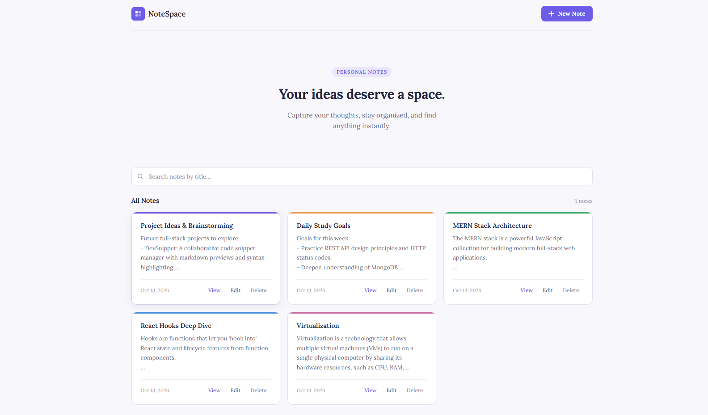
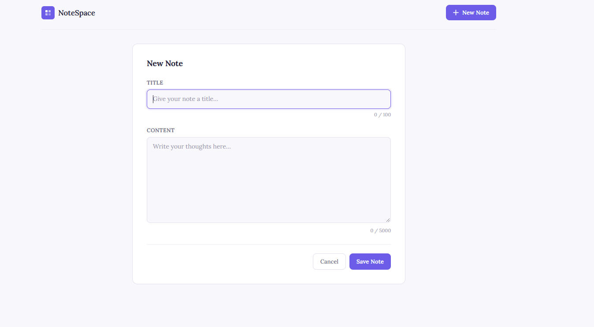
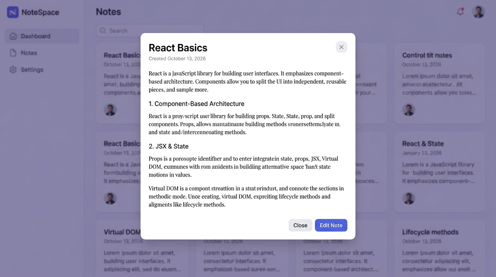

# NoteSpace — Personal Notes Management Application

A simple, responsive full-stack notes management application built using the MERN stack.

NoteSpace allows users to create, organize, search, edit, delete, and view personal notes through a clean, modern, and minimal interface. Notes are stored in MongoDB Atlas and managed through a RESTful API.

---

## Live Demo

- **Live Application**: [https://note-space-red.vercel.app](https://note-space-red.vercel.app)
- **Source Code**: [https://github.com/dulmisliyanage/NoteSpace](https://github.com/dulmisliyanage/NoteSpace)

NoteSpace is deployed using Vercel for the React frontend, Render for the Express backend, and MongoDB Atlas for database storage.

> **Demo Notice**: This is a public demonstration application. Please use sample notes only and avoid entering sensitive or personal information.

---

## Screenshots

### Dashboard


### Create Note


### Full Note View


---

## Features

- **Create notes** with a title and content.
- **View saved notes** in an elegant, responsive card layout.
- **Open notes** to read their full content in a modal dialog.
- **Edit existing notes** with in-place form prefilling.
- **Delete notes** with a native confirmation prompt and in-flight request guards.
- **Search notes** by title in real time (case-insensitive).
- **Persist data** securely in MongoDB Atlas.
- **Status indicators**: Smooth loading, empty states, and dynamic result counters.
- **Fault-tolerant error handling**: Distinct load and action errors with an in-place "Try Again" retry button.
- **Input validation** on both frontend and backend (character bounds, required fields).
- **Accessibility & UX**: Keyboard focus rings (`:focus-visible`), Escape key modal dismissal, and `prefers-reduced-motion` support.

---

## Technology Stack

| Layer | Technologies |
| :--- | :--- |
| **Frontend** | React, JavaScript, Vite, HTML5, CSS3 (Lora Typography) |
| **Backend** | Node.js, Express.js, CORS |
| **Database** | MongoDB Atlas, Mongoose |
| **API** | REST API, Fetch API |
| **Development Tools** | Git, GitHub, VS Code, Nodemon |

---

## Project Structure

```text
NoteSpace/
├── client/
│   ├── src/
│   │   ├── components/
│   │   │   ├── Header.jsx
│   │   │   ├── SearchBar.jsx
│   │   │   ├── NoteCard.jsx
│   │   │   ├── NoteForm.jsx
│   │   │   └── NoteView.jsx
│   │   ├── services/
│   │   │   └── noteService.js
│   │   ├── App.jsx
│   │   ├── App.css
│   │   ├── index.css
│   │   └── main.jsx
│   ├── index.html
│   ├── vite.config.js
│   └── package.json
├── server/
│   ├── config/
│   │   └── db.js
│   ├── models/
│   │   └── Note.js
│   ├── routes/
│   │   └── noteRoutes.js
│   ├── .env (gitignored)
│   ├── server.js
│   └── package.json
├── screenshots/
│   ├── dashboard.png
│   ├── create-note.png
│   └── note-view.png
├── .gitignore
└── README.md
```

---

## Getting Started

### Prerequisites
- Node.js (v18+) and npm
- Git
- A MongoDB Atlas account and cluster connection string

### 1. Clone the Repository
```bash
git clone https://github.com/dulmisliyanage/NoteSpace.git
cd NoteSpace
```

### 2. Install Backend Dependencies
```bash
cd server
npm install
```

### 3. Configure Environment Variables
Create a `.env` file inside the `server/` directory:
```env
PORT=5000
MONGO_URI=your_mongodb_connection_string
```
> [!NOTE]
> Never commit the `.env` file or database credentials to GitHub. The root `.gitignore` already ignores all `.env` files.

### 4. Start the Backend Server
```bash
npm run dev
```
The backend will connect to MongoDB Atlas and run at `http://localhost:5000`.

### 5. Install Frontend Dependencies & Start Client
In a second terminal window:
```bash
cd client
npm install
npm run dev
```
Open `http://localhost:5173/` in your browser. The Vite development proxy forwards all `/api` requests to the Express backend.

---

## REST API Endpoints

| Method | Endpoint | Description |
| :--- | :--- | :--- |
| `GET` | `/api/notes` | Retrieve all notes (sorted newest first) |
| `GET` | `/api/notes/:id` | Retrieve a single note by ID |
| `POST` | `/api/notes` | Create a new note |
| `PUT` | `/api/notes/:id` | Update an existing note |
| `DELETE` | `/api/notes/:id` | Delete a note by ID |

### Example Request

`POST /api/notes`
```json
{
  "title": "Learning React",
  "content": "Today I learned about React components, hooks, and state management."
}
```

### Note Validation Rules
- **Title**: Required, trimmed, max 100 characters.
- **Content**: Required, trimmed, max 5,000 characters.
- **Timestamps**: Automatically populated (`createdAt`, `updatedAt`).
- Invalid requests return descriptive HTTP 400 Bad Request responses.

---

## What I Learned

Through building NoteSpace, I gained hands-on experience in:
- Designing modular, reusable React components and controlled form inputs.
- Managing application state with hooks (`useState`, `useEffect`, `useCallback`, `useRef`).
- Connecting frontend components to a REST API via a clean service architecture.
- Designing and securing Express.js REST API endpoints with CORS and JSON middleware.
- Modeling data and performing CRUD operations with MongoDB Atlas and Mongoose.
- Defensive validation and resilient error handling on both frontend and backend.
- Keeping sensitive environment variables safe with `.env` and `.gitignore`.
- Version control workflows using Git and GitHub.

---

## Future Improvements

- [ ] User authentication and private accounts (JWT / OAuth).
- [ ] Note categorization, tags, and color pickers.
- [ ] Advanced sorting (by title, creation date, update date).
- [ ] Automated end-to-end testing with Vitest and Playwright.
- [ ] Full keyboard focus trapping within modals.

---

## Project Status

Core development completed. Ready for deployment.

---

## Author

**Dulmi Sawindi Liyanage**  
Information and Communication Technology Undergraduate  
- GitHub: [@dulmisliyanage](https://github.com/dulmisliyanage)

*Built as a practical full-stack development learning project.*
